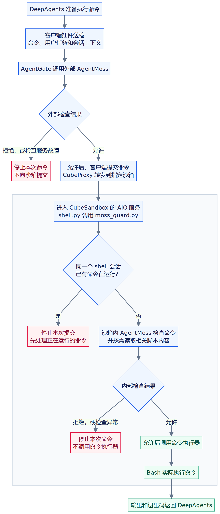

# CubeSandbox 接入

本目录帮助你把 AgentMoss 接到 CubeSandbox，让 DeepAgents 在沙箱里执行任务时，先检查工具调用，再执行命令。除了命令本身，沙箱中的脚本文件也可以交给 AgentMoss 检查。

这里提供镜像构建配置、应用示例和检查脚本。客户端使用项目已有的 [DeepAgents 插件](../deepagents-plugin/README.md)，无需另写一套沙箱客户端。

## 各个组件做什么

AIO 是沙箱里提供命令执行、文件读写等接口的服务。CubeProxy 负责把请求送到正确的沙箱。

外部 AgentMoss 能看到工具调用和会话上下文，但不能直接读取另一台机器上沙箱里的脚本。因此，外部检查和沙箱内部检查需要分别部署。沙箱内部直接调用 AgentMoss 的 Python 接口，不需要再启动一套 AgentGate 服务。

### Moss 拦截如何生效

要让下面两处检查都生效，DeepAgents 主代理和子代理需要注册安全检查插件，外部 Gate/Moss 服务需要可用，沙箱也需要从本目录构建的新镜像创建。构建镜像时，脚本会修改 AIO 的 `shell.py`，使它在执行命令前调用 `moss_guard.py`。



[查看流程图源文件](docs/moss-interception.mmd)

**只有外部检查和沙箱内部检查都允许，本次命令才会交给 Bash 执行。** 图中沿用示例的 `fail_closed: true` 配置：外部检查服务故障时也停止提交。内部检查拒绝或出错时，`moss_guard.py` 不会调用命令执行器。

图中展示的是本接入方案的命令执行流程；文件、代码执行及其他入口的覆盖范围见下方“使用时需要注意什么”。

| 文件 | 用途 |
| --- | --- |
| [image/Dockerfile](image/Dockerfile) | 从当前项目源码构建带 AgentMoss 检查的 AIO 镜像 |
| [config.example.json](config.example.json) | 应用连接 Gate 和沙箱所需的配置 |
| [examples/deepagents_aio.py](examples/deepagents_aio.py) | 在已有 DeepAgents 应用中接入，使用应用自己的模型 |
| [verify.py](verify.py) | 检查普通命令、外部拦截、沙箱内脚本拦截和会话清理 |

## 1. 准备环境

先获取[项目源码](../../../README.md#快速开始)。除特别说明外，下面的命令都在仓库根目录执行。

- 客户端需要 Python 3.12 或更新版本，并安装 `uv`。
- 构建镜像需要 Docker。本目录固定的基础镜像是 **AIO 1.11.0、Linux ARM64、Python 3.12**，请在 ARM64 构建机上执行镜像构建。
- 需要可用的 CubeSandbox 服务，以及创建模板和沙箱实例的权限。
- DeepAgents 应用所在机器需要能访问 AgentGate 和 CubeProxy；AgentGate 需要能访问外部 AgentMoss。

构建时需要下载基础镜像和 Python 依赖。基础镜像的内容摘要已固定在 Dockerfile 中。构建脚本还会核对 AIO 的命令执行入口；如果入口与已适配版本不同，构建会停止。换用其他 AIO 版本时，需要先核对入口并重新测试。

## 2. 启动外部 AgentMoss 和 AgentGate

按[服务部署说明](../deepagents-plugin/docs/deployment.md)安装两个服务、生成各自的访问令牌并启动。下面使用这组地址举例：

| 服务 | 示例地址 | 谁连接它 |
| --- | --- | --- |
| AgentMoss | `http://127.0.0.1:9090` | AgentGate |
| AgentGate | `http://127.0.0.1:9100` | DeepAgents 应用 |

服务部署在其他机器时，将 `127.0.0.1` 换成调用方能访问的地址。

先检查 AgentGate：

```bash
curl -sS http://127.0.0.1:9100/api/v1/health
```

响应中的 `status` 和 `moss_status` 都应为 `healthy`。只有 Gate 正常、Moss 不正常时，风险调用也可能被拒绝，但那是服务连接失败，不能算安全规则检查通过。

初次验证建议按部署说明关闭模型分析，使用本地规则检查。本文的检查脚本不调用任何外部模型接口。

## 3. 构建沙箱镜像

在 ARM64 构建机上，从仓库根目录执行：

```bash
docker build \
  -f AgentMoss/integrations/cubesandbox/image/Dockerfile \
  -t aio-agentmoss:1.11.0 .
```

构建会把当前 `AgentMoss/` 源码安装到 AIO 使用的 Python 环境，并在命令执行入口接入检查。镜像内使用项目内置规则，不调用外部模型服务。

命令被拒绝时，AIO 返回 `403`；检查本身出错时返回 `503`。这两种情况下均不提交命令。如果同一个 shell 会话已有命令在运行，会返回 `409`，需要先确认旧命令的状态。

## 4. 用新镜像创建沙箱

将上一步镜像放到你的 CubeSandbox 部署能够使用的位置。如果构建机和运行节点不同，先按现有部署方式上传到镜像仓库。然后通过你正在使用的 CubeSandbox 管理工具完成这几步：

1. 用该镜像创建 AIO 沙箱模板，等待模板就绪。
2. 从新模板创建一个沙箱实例，等待实例启动完成。已运行的旧沙箱不会自动换成新镜像。
3. 确认实例内的 AIO 服务监听 `8080`，并确认工作目录存在且可写，示例使用 `/home/gem`。
4. 记下 CubeProxy 地址、沙箱 ID；若开启了流量鉴权，还要准备该沙箱的流量令牌文件。

模板发布和实例创建由 CubeSandbox 的部署工具负责，本目录的客户端只连接已经创建的实例。不同部署的管理工具和镜像发布方式可能不同，不要把 AIO 服务地址当成创建沙箱的管理地址。

| 配置项 | 应填写的内容 |
| --- | --- |
| `proxy_url` | 客户端能访问的 CubeProxy 基础地址，例如 `http://cubeproxy.example:8080` |
| `sandbox_id` | 新创建实例的 ID，不是模板 ID |
| `working_dir` | 沙箱里的工作目录，例如 `/home/gem` |
| `traffic_token_file` | 可选，CubeSandbox 流量令牌文件的路径 |
| `route_host` | 可选，自定义路由时使用；默认是 `8080-<sandbox_id>.cube.app` |

默认路由通过请求的 `Host` 头指定沙箱。`proxy_url` 不需要拼上沙箱 ID，也不要把令牌写进 URL。Gate 令牌与 CubeSandbox 流量令牌用途不同，需要分别配置。

## 5. 安装客户端并检查接入

为 DeepAgents 应用单独准备一个 Python 环境：

```bash
uv venv --python 3.12 .venv-deepagents
uv pip install --python .venv-deepagents/bin/python -e './AgentMoss[deepagents-aio]'
```

AgentGate 服务与 DeepAgents 应用使用不同环境，避免依赖版本冲突。检查脚本直接访问 Gate 的 HTTP 接口，客户端环境不需要安装 AgentGate。

根据实际部署设置地址和令牌文件：

```bash
export MOSS_GATE_URL=http://127.0.0.1:9100
export MOSS_GATE_TOKEN_FILE="$HOME/.config/agentmoss-deployment/gate.token"
export MOSS_AIO_URL=http://cubeproxy.example:8080
export MOSS_SANDBOX_ID=your-sandbox-id
export MOSS_WORKING_DIR=/home/gem

# 仅在 CubeSandbox 开启流量鉴权时设置。
# export MOSS_AIO_TRAFFIC_TOKEN_FILE=/path/to/cube-traffic-token
# 仅在使用自定义路由时设置。
# export MOSS_AIO_ROUTE_HOST=your-route-host

.venv-deepagents/bin/python AgentMoss/integrations/cubesandbox/verify.py
```

脚本会依次检查并打印五项 `PASS`：

1. 外部 AgentGate 和 AgentMoss 服务正常。
2. 普通命令经过检查后，在沙箱中成功执行。
3. 外部检查拒绝风险命令。
4. 外部只看到脚本路径并放行，沙箱内部读到脚本内容后拒绝执行。
5. 临时检查文件和本次 shell 会话已清理。

测试使用预先写好的工具调用，不需要模型账号。测试命令中的敏感文件访问放在不会执行的条件内，即使内部检查没有生效，也不会读取敏感文件。测试会通过文件接口写入一个临时脚本，结束时删除它，并查询 AIO 会话列表确认本次会话已移除；整个沙箱实例仍由你管理。

## 6. 接到自己的 DeepAgents 应用

复制 [config.example.json](config.example.json)，填写 Gate 地址、Gate 令牌文件、CubeProxy 地址和沙箱 ID。有流量令牌时，在 `aio` 中补上 `traffic_token_file`。保留 `fail_closed: true`，检查服务不可用时就会停止执行。

[应用示例](examples/deepagents_aio.py)提供 `run_once()`，接收应用现有的模型、会话保存器和连接配置。例如，在已有应用代码中调用：

```python
import json
import sys
from pathlib import Path

sys.path.insert(0, "AgentMoss/integrations/cubesandbox/examples")
from deepagents_aio import run_once

async def handle_task(model, checkpointer, config_path, session_id, user_text):
    config = json.loads(Path(config_path).read_text())
    return await run_once(
        model, checkpointer, session_id, user_text, config=config,
    )
```

`model` 使用应用已经配置好的模型；`checkpointer` 是应用已有的会话保存器，不需要保存会话时可以传 `None`。示例为主代理和通用子代理都添加了安全检查。

示例每次运行后关闭 shell 会话。长期运行的服务可以在启动时创建并复用集成实例，停止接收任务并等待已有任务结束后，再调用 `integration.aclose()`。同一个实例串行使用一个 shell 会话；需要并行处理独立任务时，使用不同的集成实例。沙箱实例的创建和销毁仍由应用负责。

## 使用时需要注意什么

- **检查覆盖的入口有限。** 镜像检查覆盖 AIO 的 `/v1/shell/exec` 和兼容命令入口 `/v1/shell/write`。文件接口、代码执行接口、WebSocket 终端、MCP 的 `sandbox_execute_bash`，以及 CubeSandbox SDK 的 `commands.run()` 不经过这两个入口。不能把本目录的接入理解为对沙箱内所有操作的统一拦截。
- **文件工具依靠客户端检查。** 通过已注册中间件的 DeepAgents 文件工具调用会先交给 Gate；直接调用底层文件接口不会经过该中间件。写文件还需要 AIO 的 Python 代码执行接口可用。
- **使用完整的沙箱路径。** 推荐传 `/home/gem/file.txt` 这样的绝对路径。单独执行 `cd` 不会改变下一条命令的起始目录；在同一条命令中使用 `cd subdir && ...` 才有效。工作目录也不等于文件访问权限边界。
- **区分两处拒绝。** 外部拒绝时，命令不会送到 AIO。外部允许、内部拒绝时，工具返回执行错误和 `AGENTMOSS_DENIED`；退出码 `126` 是客户端用于表示 AIO 拒绝的值，不是 Bash 实际执行后的结果。
- **超时后先查旧命令。** 网络断开或超时不能说明命令没有执行。客户端会停止继续使用状态不明的会话，不自动重试或转到本地执行。先确认并处理旧会话，再重新连接；新建会话不会停止旧命令。
- **内外文件系统互不共享。** 外部 Moss 如果恰好存在同名脚本，可能额外检查外部那份文件。`integration.status()` 也不能证明镜像内的检查已经启用，应运行上面的接入检查。
- **静态检查存在已知限制。** 对部分 `python -c` 命令，写在错误处理函数中的敏感文件读取可能未被当前引擎拦截。部署时仍需配置沙箱自身的文件访问权限；本接入不能替代这些权限限制。

## 常见问题

| 现象 | 处理方法 |
| --- | --- |
| `moss_status` 不是 `healthy` | 检查外部 Moss 的实际监听端口、Gate 的 `security-url` 和 Moss 令牌 |
| 普通命令被拒绝，来源是 `fail_closed` | 检查 Gate 地址、令牌和响应时间；示例将 Gate 等待时间设为 30 秒 |
| 普通命令成功，脚本检查失败 | 确认实例来自新镜像，并且调用走的是 AIO shell 接口 |
| `AGENTMOSS_UNAVAILABLE` | 查看 AIO 服务日志，检查镜像内 AgentMoss 初始化和规则加载情况；此时不会提交命令 |
| `AGENTMOSS_SESSION_BUSY` 或 `409` | 先查看并处理同一个 shell 会话里尚未结束的命令 |
| 创建实例返回 `no more resource` | 检查 CubeSandbox 节点与模板的调度状态；这发生在 AIO 接入之前 |
| 构建提示 AIO 执行入口不匹配 | 核对基础镜像版本；不要跳过校验，需针对新入口重新适配 |

更详细的客户端参数和故障处理见 [DeepAgents 插件说明](../deepagents-plugin/README.md)。
