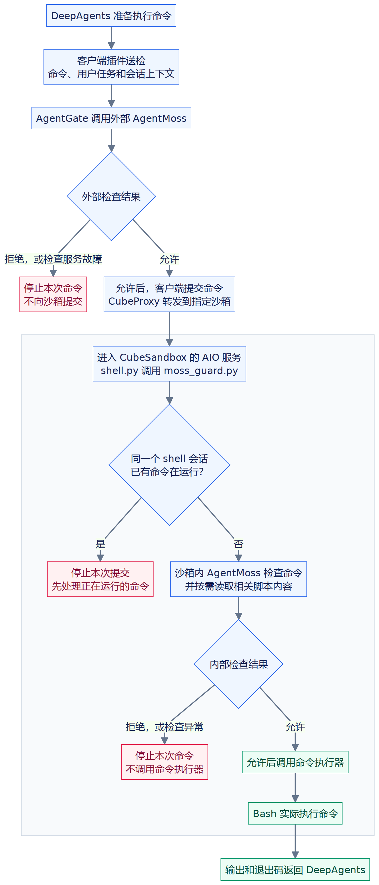

# 连接 Deep Agents 与 CubeSandbox

Deep Agents 把工具调用、用户请求和会话历史发给 AgentGate，由外部 AgentMoss 判定。允许执行的 shell 命令经 CubeProxy 到达 AIO。沙箱镜像内的 AgentMoss 可以读取沙箱文件，在启动 Bash 前检查命令及其引用的脚本。



## 准备应用环境

先按[服务部署说明](deployment.md)启动 AgentGate 和 AgentMoss，再按[沙箱部署说明](../../cubesandbox/README.md)从带 AgentMoss 的镜像创建实例。应用所在主机需要能访问 AgentGate 和 CubeProxy，并能读取 Gate 令牌及该沙箱的流量令牌。

如已按[本地接入说明](../README.md#安装)安装 `deepagents-aio`，可直接使用同一个应用环境。首次安装时，在应用机器的仓库根目录执行以下命令。

```bash
uv venv --python 3.12 .venv-deepagents
uv pip install --python .venv-deepagents/bin/python './AgentMoss[deepagents-aio]'
```

## 配置连接

复制[配置示例](../../cubesandbox/config.example.json)到应用自己的配置目录，设好以下字段。

| 字段 | 填写内容 |
| --- | --- |
| `backend` | `"aio"` |
| `gate.gate_url`、`gate.api_token_file` | 应用可访问的 AgentGate 地址和 Gate 令牌文件的绝对路径。保留 `fail_closed: true`，服务异常时停止执行。 |
| `aio.proxy_url`、`aio.sandbox_id` | CubeProxy 基础地址和实例 ID，对应创建沙箱时的 `MOSS_AIO_URL` 和 `MOSS_SANDBOX_ID`。 |
| `aio.traffic_token_file` | 对于启用流量鉴权的实例，在 `aio` 中添加此字段，填写应用机器上沙箱流量令牌文件的绝对路径。 |
| `aio.route_host` | 默认 `8080-<sandbox_id>.cube.app`。集群使用自定义域名时，填写创建沙箱时得到的完整路由主机名。 |
| `aio.working_dir` | 沙箱中已存在、可写的绝对路径。示例使用 `/home/gem`。 |

## 在应用中调用

[deepagents_aio.py](../../cubesandbox/examples/deepagents_aio.py) 提供 `run_once()`。已有应用可以将这个文件放到自己的 Python 模块目录，从异步入口调用 `await run_once(model, checkpointer, session_id, user_text, config=config)`。其中 `model` 是支持工具调用的聊天模型，`checkpointer` 用于保存对话状态，无需跨请求恢复时可传 `None`。

首次运行可使用 Deep Agents 自带的 Anthropic 适配器。在应用机器的仓库根目录，将 `MOSS_APP_CONFIG` 换为前面填写的 JSON 文件，再输入账户可用的模型 ID 和 API Key。

```bash
export MOSS_APP_CONFIG=/path/to/aio-config.json
read -r -p 'Anthropic 模型 ID：' ANTHROPIC_MODEL
read -r -s -p 'Anthropic API Key：' ANTHROPIC_API_KEY && echo
export ANTHROPIC_MODEL ANTHROPIC_API_KEY

PYTHONPATH=AgentMoss/integrations/cubesandbox/examples .venv-deepagents/bin/python - <<'PY'
import asyncio
import json
import os
from pathlib import Path
from uuid import uuid4

from deepagents_aio import run_once
from langchain_anthropic import ChatAnthropic

config = json.loads(Path(os.environ["MOSS_APP_CONFIG"]).read_text(encoding="utf-8"))
result = asyncio.run(run_once(
    ChatAnthropic(model=os.environ["ANTHROPIC_MODEL"]), None, uuid4().hex,
    "请使用 execute 执行 pwd，告诉我沙箱中的工作目录。", config=config,
))
print(result["messages"][-1].content)
PY
```

模型调用 `execute` 后，工具应返回配置中的沙箱目录，如 `/home/gem`。同一个插件也支持在应用主机上执行命令，见[本地接入示例](../README.md#在应用中接入)。

示例为主代理和通用子代理都注册了检查中间件，并在每次调用结束时关闭 shell 会话。添加其他子代理时，也需要为它们配置中间件。沙箱实例由创建它的应用管理。长期复用集成时，每个实例串行使用一个 shell 会话，应用退出前应等待任务结束并调用 `await integration.aclose()`。

## 检查连接与拦截

需要确认两层检查是否生效时，在创建实例的终端运行下面的命令。如果应用位于其他机器，先在应用机器设置相同的沙箱连接变量，并将令牌路径指向该机器上的文件。将 `MOSS_GATE_URL` 和 `MOSS_GATE_TOKEN_FILE` 换为部署时的值。

```bash
export MOSS_GATE_URL=http://127.0.0.1:9100
export MOSS_GATE_TOKEN_FILE="${XDG_CONFIG_HOME:-$HOME/.config}/agentgate/auth_token"
.venv-deepagents/bin/python AgentMoss/integrations/cubesandbox/verify.py
```

命令会创建并关闭一次 AIO shell 会话，在工作目录写入后清理临时文件。输出全部为 `PASS` 表示普通命令可执行，外部规则和沙箱内脚本检查均已生效。

## 路径和执行结果

- **工作目录**　每条命令从 `working_dir` 开始。要切换目录并执行任务，可在同一条命令中使用 `cd subdir && ...`。文件工具请传沙箱内的绝对路径，如 `/home/gem/report.txt`。
- **拒绝执行**　外部检查拒绝时，命令会停在应用侧。沙箱内的规则拒绝时，工具返回 `AGENTMOSS_DENIED` 和适配器退出码 `126`。权限、连接和检查故障可按[沙箱响应说明](../../cubesandbox/README.md#执行命令)排查。
- **执行状态未知**　超时或连接中断时，先查询旧 shell 会话和命令状态，再决定是否重新执行，以免重复操作。
- **文件操作**　注册了中间件的文件工具会经过外部检查。直接调用 AIO 文件接口时，需要由沙箱自身的访问控制保护文件。外部服务与沙箱各自使用本机文件系统。
