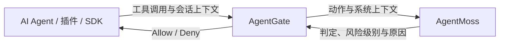

# AgentMoss

基于鲲鹏硬件的智能体运行时安全检测方案。

## 项目介绍

### 概述

AgentMoss 面向 AI Agent 的工具调用安全场景，在命令执行、文件读写等动作发生前，结合用户意图、调用历史和系统上下文进行安全分析，返回 `Allow` 或 `Deny` 判定，帮助接入方识别和阻断高风险操作。

本项目包含 **AgentMoss** 和 **AgentGate** 两个组件：AgentMoss 提供多层安全分析能力，AgentGate 提供 Agent 接入、上下文采集与调用审计能力。两个组件通过 HTTP API 协同工作，接入方根据返回的判定决定是否执行原工具。

### 架构



一次工具调用的处理流程：

1. Agent 通过插件、SDK 或 HTTP API，将待执行的动作及上下文发送给 AgentGate。
2. AgentGate 采集系统信息、整理会话历史，将分析请求转发给 AgentMoss。
3. AgentMoss 结合规则与上下文进行安全分析，返回判定、风险级别和原因。
4. AgentGate 保存调用与判定记录并返回结果，Agent 接入方执行允许的动作或拒绝被拦截的动作。

## 组件介绍

| 组件 | 主要职责 | 使用文档 |
| --- | --- | --- |
| AgentMoss | 安全分析引擎，提供特征匹配、逻辑规则、形式化验证及可选的 LLM 语义分析能力 | [AgentMoss](./AgentMoss/README.md) |
| AgentGate | Agent 接入与数据采集中间层，提供上下文采集、会话历史整理、请求转发、调用记录及可视化看板 | [AgentGate](./AgentGate/README.md) |

AgentMoss 也支持作为 Python 库直接使用；AgentGate 提供 Python SDK 和 HTTP 接口，便于对接不同 Agent 框架。

## 特性介绍

| 分类 | 特性 | 说明 |
| --- | --- | --- |
| 安全分析 | L1 特征检测 | 识别危险命令、注入特征及敏感规则，支持脚本内容预扫描 |
| 安全分析 | L2 逻辑与行为检测 | 结合动作历史检查读写关系、敏感路径、危险模式及用户意图，支持行为图形式化验证与跨会话组合链分析 |
| 安全分析 | L3 语义检测 | 结合 LLM 与安全 Skill 进行深度语义分析，可通过配置按需启用 |
| 规则扩展 | 多维规则配置 | 支持内置规则、用户扩展规则、Agent 专属规则及部署场景规则 |
| 接入与采集 | 工具调用接入 | 支持通过插件、Python SDK 或 HTTP API，在工具执行前提交分析请求 |
| 接入与采集 | 上下文整理 | 采集系统、进程、网络、用户与环境信息，整理会话调用历史 |
| 审计与可视化 | 调用追踪 | 保存动作与判定记录，提供会话轨迹、调用查询、统计和时间线 |
| 审计与可视化 | 管理界面 | AgentGate 提供 Dashboard，AgentMoss 提供规则与运行配置 Console |
| 接口保护 | 鉴权与访问控制 | 支持 Token 鉴权、来源校验、请求限流及调用数据访问控制 |

## 目录结构

```text
AgentMoss/
├── AgentMoss/                    # 安全分析引擎
│   ├── agent_moss/               # 引擎、规则、Skill、HTTP 服务与 Console
│   ├── integrations/             # Agent 插件与适配器
│   ├── tests/                    # 引擎测试与测试语料
│   └── README.md                 # 引擎安装、配置与使用说明
├── AgentGate/                    # 接入、采集与审计组件
│   ├── agent_gate/               # HTTP 服务、采集、存储与 Dashboard
│   ├── sdk/                      # 独立客户端
│   ├── config/                   # 配置示例
│   └── README.md                 # 网关安装、配置与使用说明
└── README.md                     # 项目总览
```

## 快速开始

### 环境准备

两个组件均要求 Python 3.10 或更高版本，使用 uv 管理依赖和运行环境。请先安装 uv；以下示例使用 Python 3.12，在项目根目录执行：

```bash
uv sync --project ./AgentMoss --python 3.12
uv sync --project ./AgentGate --python 3.12
```

两个组件分别使用各自目录下的 `.venv` 和 `uv.lock`，无需手动激活环境。首次同步会生成锁文件，应将其纳入版本控制；后续按锁定版本安装依赖：

```bash
uv sync --project ./AgentMoss --locked
uv sync --project ./AgentGate --locked
```

第三方 Agent 插件的 Python 版本与依赖要求见各自接入文档。

### 启动 AgentMoss

在第一个终端中，从项目根目录启动 L1/L2 检测服务：

```bash
AGENT_MOSS_DISABLE_LLM=1 uv run --project ./AgentMoss --locked \
  agent-moss server --host 127.0.0.1 --port 9090
```

L1/L2 不需要模型凭据。启用 L3 时，需要配置模型接口、模型名称及 API Key，具体见 [AgentMoss 配置说明](./AgentMoss/README.md#配置)。

### 启动 AgentGate

在第二个终端中，从项目根目录启动 AgentGate，并指定 AgentMoss 的服务地址：

```bash
uv run --project ./AgentGate --locked \
  agent-gate server --host 127.0.0.1 --port 9100 \
  --security-url http://127.0.0.1:9090
```

AgentMoss 在指定端口被占用时会自动选择后续可用端口；请根据其启动日志，将 `--security-url` 设置为实际监听地址。两个服务以同一用户运行且使用默认数据目录时，AgentGate 会自动读取 AgentMoss 的访问凭据；其他部署方式见组件文档。

### 验证与访问

```bash
curl http://127.0.0.1:9090/api/v1/health
curl http://127.0.0.1:9100/api/v1/health
```

| 服务 | 默认入口 |
| --- | --- |
| AgentGate API | `http://127.0.0.1:9100/api/v1/analyze` |
| AgentGate Dashboard | `http://127.0.0.1:9100/dashboard/` |
| AgentMoss API | `http://127.0.0.1:9090/api/v1/analyze` |
| AgentMoss Console | `http://127.0.0.1:9090/console` |

默认启用鉴权，首次启动会生成访问令牌。Linux 默认令牌路径分别为 `~/.config/agentgate/auth_token` 和 `~/.config/agentmoss/auth_token`；设置 `XDG_CONFIG_HOME`、`AGENT_MOSS_DATA_DIR` 或显式凭据配置时，以实际配置为准。

API 调用使用 `Authorization: Bearer <token>`。浏览器可通过 `http://127.0.0.1:9100/dashboard/?token=<Gate令牌>` 登录看板；Console 使用对应的 Moss 令牌。更多请求示例与参数见组件使用文档。

## 文档与接入

| 文档 | 内容 |
| --- | --- |
| [AgentMoss 使用说明](./AgentMoss/README.md) | 引擎安装、检测层级、API、规则扩展和配置 |
| [AgentGate 使用说明](./AgentGate/README.md) | 网关安装、API、鉴权、存储与服务部署 |
| [Python 独立客户端](./AgentGate/sdk/python/gate_client.py) | 通过 AgentGate 提交分析请求 |
| [QwenPaw 插件](./AgentMoss/integrations/qwenpaw-plugin/README.md) | 在权限检查环节接入 Gate/Moss |
| [DeepAgents 插件](./AgentMoss/integrations/deepagents-plugin/README.md) | 通过中间件接入主代理与子代理的工具调用 |

## 贡献、建议与交流

欢迎通过本仓库的 Issues 反馈问题、提出建议或提交特性需求。反馈问题时，请提供组件版本、运行环境、复现步骤及必要的脱敏日志。

提交代码时，请说明改动目的及验证方法，并运行相关组件的测试。测试入口见 [AgentMoss 开发与测试](./AgentMoss/README.md#开发与测试) 和 [AgentGate 开发与测试](./AgentGate/README.md#开发与测试)。

## 许可证

本仓库中的 AgentMoss 和 AgentGate 组件均采用 MIT License，具体条款分别见 [AgentMoss/LICENSE](./AgentMoss/LICENSE) 和 [AgentGate/LICENSE](./AgentGate/LICENSE)。
